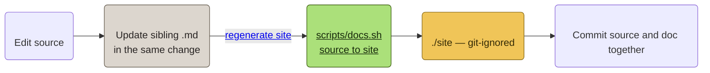

# AGENTS.md



Instructions for AI coding agents working in this repo.

## What this is

`versioner` is a small Go CLI that computes

```text
VERSION = <branch-version>.<major>.<minor>.<revision>.<patch>
TAG     = "v" + VERSION
```

from git history. It is the Go replacement for a legacy shell script
(`get_version.sh`); that script is **not** in this repository — `versioner`
is the canonical implementation.

The binary is meant to be cross-compiled (`CGO_ENABLED=0`) and dropped into
git-based software projects. It shells out to `git` but has no third-party
Go dependencies.

## Source layout

- `main.go` — CLI flags (`flag` pkg), config precedence, output formats
  (`text`/`shell`/`json`), exit codes (`0` ok, `1` compute, `2` usage/config).
- `config.go` — `Config`, defaults, `.versioner.json` loading, `VERSIONER_*`
  env overlay, exempt-branch parsing (JSON or `a=1,b=2`).
- `version.go` — pure version rules (`ParseTag`, `ClassifyCommit`,
  `ApplyBump`), git plumbing via a stubbable `gitRun` func var, `Compute`.
- `*_test.go` — table/'stubbed-git' unit tests.
- `Makefile` — `build`/`test`/`vet`/`cross`/`clean`.
- `scripts/release.sh` — dogfooding release: builds `versioner`, computes
  `TAG`, runs `make cross` with `VERSION=$TAG` to
  `dist/<arch>/versioner[.exe]`, packs each into
  `dist/Versioner_<tag>_<arch>.tar.gz` (`.zip` on Windows) with
  README/LICENSE, tags/pushes, and `gh release create`s the archives +
  `checksums.txt` (`--dry-run` to preview). There is no 7zip anywhere.
- `scripts/` — the env cascade (`env.sh`, `entry.sh`, `.common.env`,
  `.<platform>.env`), `version.sh`, `build.sh`, `docs.sh`.
- `tools/` — bundled binaries from the sibling `fordaj/*` repos
  (`barnacle`, `formattington-lite`, `logamuffin`, `runner-spawner`).
  One `update.sh` per tool refreshing them from the upstream GitHub
  releases (platform-native `.tar.gz`/`.zip` assets; legacy `.7z`
  still accepted); the per-tool scripts are thin wrappers over the
  shared `tools/update.sh` implementation (sibling page
  `tools/update.md`). `scripts/entry.sh` exposes `log()`
  (logamuffin-backed).
- `.formattington.json` — formatting configuration (formattington); the
  repo formats itself with it via `./scripts/format.sh` / `./ci/format_check.sh`.
- `.runner-spawner.json` — self-hosted runner provisioning for this repo
  (consumed by `runner-spawner create`).
- `.versioner.json` — this repo's own configuration (`main` → `0`).
- `README.md` — user-facing docs. Keep flag/env/config tables in sync with
  `main.go` and `config.go`.
- `*.md` siblings of the above (and of every script) — the barnacle
  documentation pages; see "Documentation files (barnacle)" below.

## Invariants — do not change casually

These mirror the legacy shell script exactly; changing them breaks parity
and every project that depends on the version numbers.

1. **Base from the tag.** `git describe --tags --abbrev=0 --match <pattern>`
   (default `v[0-9]*`). Seed `major/minor/revision` from the tag's
   `v<branch>.<major>.<minor>.<revision>.<patch>`; **overwrite `patch`**
   with `git rev-list <tag> --count` (`version.go:Compute`). No tag ⇒ base
   `0.0.0.0`.
2. **Replay after tagging.** Commit subjects after the tag (or all when
   untagged) oldest-first; every commit bumps `patch`.
3. **Conventional prefixes (case-insensitive, before the first `:`):**
   breaking (`feat!`/`feature!`/`fix!`, with optional `(scope)`) ⇒ `major++`
   - reset `minor`/`revision`; `feat`/`feature` ⇒ `minor++` + reset
     `revision`; `fix` ⇒ `revision++`. Unrecognised types (and breaking
     unrecognised types) bump `patch` only.
4. **Branch version.** Exempt branch ⇒ its value, else default `254`
   (including detached `HEAD`). `Compute` resolves branch before replay.
5. **Text output is a compatibility surface.** Default `text` format prints
   `LAST_TAG=`, one subject + ` -> <version>` line per replayed commit,
   then `VERSION=`/`TAG=`. Only add new flags/formats; do not alter or
   remove these lines.

## Configuration precedence

`defaults < .versioner.json < VERSIONER_* env < CLI flags` (`main.go:run`).
Unset flags must never clobber env/file values (flags default to sentinel
values: `""`, `-1`, `false` — check before applying).

`.versioner.json` fields: `defaultBranchVersion`, `exemptBranches`,
`tagPattern`, `repoDir`, `head` (all optional). Env vars:
`VERSIONER_CONFIG`, `VERSIONER_REPO_DIR`, `VERSIONER_HEAD`,
`VERSIONER_BRANCH`, `VERSIONER_TAG_PATTERN`,
`VERSIONER_DEFAULT_BRANCH_VERSION`, `VERSIONER_EXEMPT_BRANCHES` (JSON or
list, merges per-branch over the file), `VERSIONER_FORMAT`, `VERSIONER_QUIET`.

Do not reintroduce sourcing `env.sh` or any arbitrary shell file — it is
intentionally not supported (security/portability). Point users at the
JSON/env/flags instead.

## Working here

```sh
gofmt -w .          # format
go vet ./...        # must pass
go test ./...       # must pass; add coverage for new pure logic
make build          # ./versioner
make cross          # ./dist/ binaries for 5 targets
./scripts/release.sh --dry-run   # preview dogfooding release (no tag/push)
./scripts/docs.sh                # regenerate the documentation site into ./site/
./scripts/format.sh                   # format in place (formattington via uv)
./ci/format_check.sh          # CI formatting gate
```

CI (`.github/workflows/ci.yml`) runs on self-hosted macOS and Windows runners
(managed by `tools/runner-spawner/` per the committed `.runner-spawner.json`):
Check Formatting (`./ci/format_check.sh`) and Test (`go vet ./...`, `gofmt`
check, `go test ./...`, `go build ./...`). There is no GitHub-hosted Linux
compute.

- Use `gofmt`; run `go vet`/`go test` before finishing any change.
- Pure logic (parsing, bumping, config overlay) should stay pure and
  table-tested. Stub git in tests via the `gitRun` variable (`stubGit`
  helper in `version_test.go`) rather than building real repos.
- New flags: add to `run()` in `main.go`, document in `--help` and
  `README.md`, respect precedence (sentinel default + explicit-only apply).
- New config knobs need all three layers: `Config` field, env var (if
  user-facing), and flag (if user-facing), plus `README.md` table updates.
- Error messages go to stderr as `versioner: <message>` with exit `1` for
  compute failures, `2` for bad flags/config. Never print trace lines on
  failure paths.

## Documentation files (barnacle)

The repository's documentation is a set of Markdown (`.md`) and Mermaid
(`.mmd`) source files rendered into a static site by the pinned
[barnacle](https://github.com/fordaj/barnacle) binary (`tools/barnacle/`,
wired into the environment cascade as `BARNACLE_BIN`). Generate the site
with `scripts/docs.sh`; the output (`./site/`) is git-ignored and never
committed.

Layout — documentation lives next to the code it describes:

- One sibling `.md` per Go source file at the repo root: `main.go` →
  `main.go.md`, `config.go` → `config.go.md`, `version.go` → `version.go.md`
  (test files have no pages), plus `scripts/format.sh` →
  `scripts/format.sh.md`.
- One sibling `.md` per script: `scripts/build.sh` → `build.sh.md`,
  `scripts/docs.sh` → `docs.sh.md`, `scripts/entry.sh` → `entry.sh.md`,
  `scripts/env.sh` → `env.sh.md`, `scripts/release.sh` → `release.sh.md`,
  `scripts/version.sh` → `version.sh.md`, plus `scripts/README.md` as the
  hub.
- One sibling `.md` per bundle in `tools/` (`tools/<name>/update.sh` →
  `tools/<name>/update.sh.md`: `barnacle`, `formattington-lite`,
  `logamuffin`, `runner-spawner`), plus `tools/update.sh` →
  `tools/update.md` for the shared implementation, plus `tools/README.md`
  as the hub.
  `.barnacle.json` excludes `tools/` from the scan, so these pages are
  source-only (never rendered); reference them by path in code spans —
  do not link to them from rendered pages (barnacle would emit dead
  `.html` hrefs).
- Root `README.md`, this file, and `scripts/README.md` / `tools/README.md`
  act as entry points; `ci/`, `Makefile`, `go.mod`, `.versioner.json`,
  `pyproject.toml`, and the lock files have no sibling pages.

Naming rules:

- **Retain the documented file's suffix.** A documentation file for
  `main.go` is `main.go.md`; for `scripts/docs.sh` it is `docs.sh.md`.
  This is the convention for everything in this repository, and it exists
  so files that share a base name can be documented individually.
- Free-standing diagrams that do not document one specific file
  (for example `architecture.mmd`) may use a plain name.
- Hub pages (`README.md` in each documented directory) keep their plain
  names.

Rules for keeping these files current:

- When you add, rename, remove, or repurpose a documented file — a Go
  file, a script, or a bundle — update its sibling `.md` **in the same
  change**. A new file without its page is incomplete work; a stale page
  is worse than none.
- **Every page opens with a Mermaid diagram** under its `#` heading
  (guidance, not a hard rule): what the thing is and how it fits, in the
  diagram type that fits best. If a page you touch has no diagram at the
  top, add one. The diagram answers "what am I looking at, and where does
  it fit?" for a newcomer — it is a map of the page's territory, not a
  restatement of the heading. Two or three nodes of substance beat
  decoration.
- Source every fact: the `.go`/`.sh`/`.bash` file itself, this file
  (AGENTS.md), and README.md are the accepted sources. Never invent
  flags, exit codes, extensions, or bundle-platform matrices.
- Use plain relative links (`version.go.md`, `../README.md`) with the
  linking file's `.md` path — barnacle rewrites them to `.html`. Do not
  link to files barnacle does not render (binaries, `.sh`, `LICENSE`, and
  — in this repo — anything under `tools/`); link the related `.md` page
  instead (for external references, a full `https://` URL is fine).
- Prefer `click` directives in the top-of-page diagram (`click Scan href
"scan.go.md"`) so diagram nodes navigate the generated site the same
  way Markdown links do — barnacle rewrites `.md`/`.markdown`/`.mmd`
  targets (with fragments preserved) to `.html`. Inline anchors in edge
  labels (`Idle --> Waiting : <a href="scan.go.md">send(cmd)</a>`) make
  transitions navigable too; flowchart labels with parentheses must be
  double-quoted with single-quoted hrefs inside
  (`A -->|"<a href='x.md'>send(cmd)</a>"| B`). Click targets are relative
  to the current page, exactly like Markdown links.
- A `foo.md` and a `foo.mmd` may not coexist for the same stem —
  barnacle fails the whole site rather than overwriting. The same applies
  with retained suffixes: `foo.sh.md` and `foo.sh.mmd` both generate
  `foo.sh.html`.
- Hub pages (`README.md` in each documented directory) list their
  siblings; adding a page means linking it from the hub too, in the same
  order as the rest of the directory's list.
- Barnacle skips hidden files by default, so the `.common.env` and
  `.<platform>.env` cascade is documented inside `scripts/env.sh.md` —
  keep it accurate there instead of adding hidden doc files.
- Regenerate and self-review the site before publishing:
  `scripts/docs.sh`, then click through the changed pages. The generator
  output must remain free of broken local links; barnacle prints a
  non-fatal note listing pages with no Mermaid diagram — there should be
  none.

Definition of Done addition: a change that touches any documented file
updates (or creates) its sibling page in the same commit — including the
diagram at the top.

## Parity checking (shell vs Go)

The legacy shell script is not in this repo. When changing version rules,
write scratch git repositories (`mktemp -d`) and assert `versioner`'s output
directly (`--quiet`, `--format json`) against the documented scheme above;
table-driven tests in `version_test.go`/`config_test.go` are the primary
guard. The rule semantics must not change without updating `README.md` and
this file.

## Conventions

- Conventional commit messages (`feat:`, `fix:`…) — the version rules read
  them, so be accurate: `feat!:` only when truly breaking.
- Keep the module path `github.com/fordaj/versioner` and binary name
  `versioner` stable — downstream projects reference them.
- Commit `dist/` never (it is git-ignored); binaries are built or fetched.
