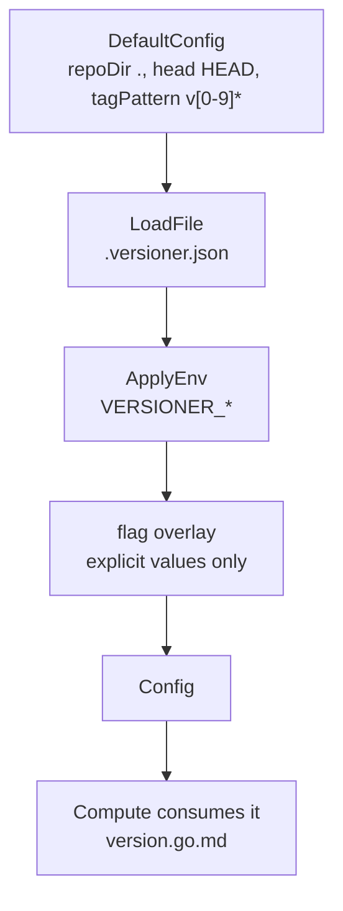

# Configuration (`config.go`)

`config.go` defines every tunable of the `versioner` CLI and the layering
of configuration sources. Consumed by [main.go.md](main.go.md) (which builds a
`Config` layer by layer) and by [version.go.md](version.go.md) (which computes
the version from a `Config`).

## The `Config` struct

Holds `RepoDir`, `Head`, `Branch`, `TagPattern`, `DefaultBranchVersion`,
and `ExemptBranches` (serialised to `.versioner.json` / env), plus two
flags-only knobs never serialised: `Format` and `Quiet`.

`DefaultConfig()` returns the built-in defaults: `repoDir` `.`, `head`
`HEAD`, `tagPattern` `v[0-9]*`, `defaultBranchVersion` `254`, empty
`exemptBranches`, `format` `text`. `DefaultConfigFile` is
`.versioner.json`.

## Key functions

- `FindConfigFile(repoDir)` — checks `repoDir/.versioner.json`, then the
  cwd's; returns `""` when none exists. An absent auto-discovered file is
  not an error.
- `LoadFile(path)` — parses a `.versioner.json` into the `Config`. A
  partial struct keeps omitted fields at their current values; unknown
  keys are ignored; the file's `exemptBranches` map _replaces_ the
  current one. Invalid JSON is an error (exit `2` via [main.go.md](main.go.md)).
- `ParseExemptBranches(s)` — JSON object (`{"main":1}`) or comma list
  (`main=1,develop=2`; `main:1` also accepted). Empty input yields an
  empty map; keys must be non-empty; values are integers.
- `ApplyEnv(getenv)` — overlays the `VERSIONER_*` variables (`getenv`
  defaults to `os.Getenv`; tests inject their own). `VERSIONER_CONFIG` is
  deliberately **not** applied here — `main` consumes it earlier to pick
  the file. Env `VERSIONER_EXEMPT_BRANCHES` entries _merge per-branch_
  over the file's map (env wins); every other env value (string overlays
  are applied from a small table) replaces the file's wholesale. Bad
  integers/booleans are errors.

Env vars honoured here: `VERSIONER_REPO_DIR`, `VERSIONER_HEAD`,
`VERSIONER_BRANCH`, `VERSIONER_TAG_PATTERN`,
`VERSIONER_DEFAULT_BRANCH_VERSION`, `VERSIONER_EXEMPT_BRANCHES`,
`VERSIONER_FORMAT`, `VERSIONER_QUIET`. Precedence: built-in defaults <
`.versioner.json` < env < CLI flags (the flag layer lives in
[main.go.md](main.go.md)).

## Where it is used

`main.go:run` — defaults → file → env → flags. `version.go:Compute`
reads the resolved `Config`. Unit tests live in `config_test.go`.

## Related pages

- [main.go.md](main.go.md) — CLI flags and output formats
- [version.go.md](version.go.md) — how the resolved config is consumed
- [README.md](README.md) — user-facing flag/env/config tables
