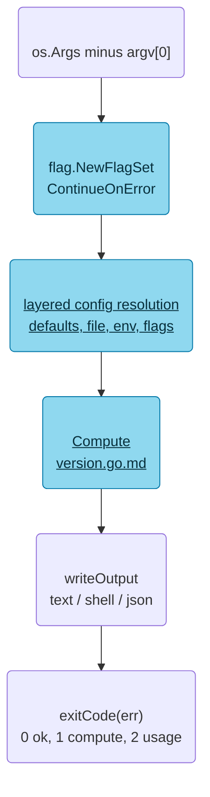

# The CLI entry point (`main.go`)

`main.go` is the `versioner` command: it parses flags, layers
configuration (defaults → `.versioner.json` → `VERSIONER_*` env → flags),
runs the computation in [version.go.md](version.go.md), and writes the result in
one of three formats.

## Entry point and exit codes

`main()` calls `run(os.Args[1:], os.Stdout, os.Stderr)` and exits with
`exitCode(err)`: `0` success, `1` computation failure, `2` bad flags or
config. `codedError` carries the code; `configErrf` builds exit-`2`,
`computeErrf` exit-`1`. Errors print to stderr as `versioner: <message>`.

`toolVersion` is stamped at link time via `-ldflags "-X main.toolVersion=<tag>"`
(default `dev`); `--version` prints `versioner <toolVersion>` and exits
`0`.

## Flags

`flag.NewFlagSet` with `ContinueOnError`. Flags: `--config`, `--repo-dir`,
`--head`, `--branch`, `--tag-pattern`, `--default-branch-version`
(sentinel `-1`), `--format`, `--quiet`, `--version`, and repeatable
`--exempt-branch` (`exemptFlag`, parsed with `ParseExemptBranches` from
[config.go.md](config.go.md); JSON also accepted). `-h`/`--help` prints usage,
exit `0`; positional arguments reject with exit `2`. Unset flags never
clobber env/file values — every flag defaults to a sentinel (`""`, `-1`,
`false`) checked before applying.

## Config resolution

1. Preliminary repo dir: `--repo-dir` > `VERSIONER_REPO_DIR` > `.`.
2. Explicit config: `--config` > `VERSIONER_CONFIG`; else
   `FindConfigFile(prelimRepoDir)`. An explicitly requested missing file
   errors (exit `2`); an absent auto-discovered file is fine; invalid
   JSON errors (exit `2`).
3. Env overlay via `ApplyEnv` (exit `2` on bad values).
4. Flag overlay (explicit values only).
5. Validate: `--format` ∈ `text|shell|json`; tag pattern non-empty;
   empty `repoDir`/`head` fall back to `.`/`HEAD`; nil `ExemptBranches`
   initialised.

## Output

`writeOutput` renders the `Compute` result:

- `text` (default) — `LAST_TAG=`, one subject + ` -> <version>` line per
  replayed commit (suppressed by `--quiet`), then `VERSION=`/`TAG=`. The
  compatibility surface with legacy `get_version.sh`; do not alter it.
- `shell` — `export` lines for `eval $(versioner --format shell)`
  (`LAST_TAG`, `VERSION_BRANCH/MAJOR/MINOR/REVISION/PATCH`, `VERSION`,
  `TAG`); values pass through `shellQuote`.
- `json` — indented object (`lastTag`, `branch`, `version`, `tag`,
  `branchVersion`, `major`, `minor`, `revision`, `patch`, `trace[]`).

## Related pages

- [config.go.md](config.go.md) — the `Config` struct, env vars, precedence
- [version.go.md](version.go.md) — the computation invoked by `run`
- [README.md](README.md) — flag/env/config reference for users
