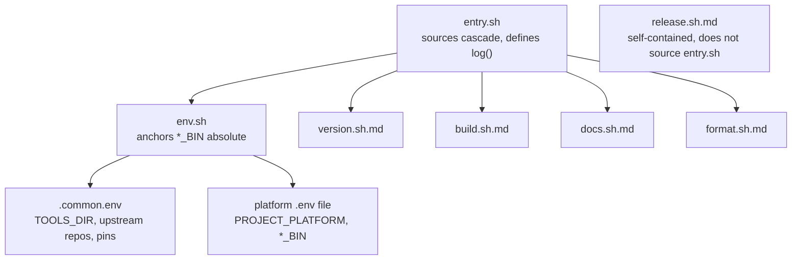

# Repository script tooling (`scripts/`)

The `scripts/` directory carries the repository's build/release/docs/version
tooling: an environment cascade the other scripts source, plus one entry
point per task. Everything here is bash; nothing requires a global install
beyond what each script documents.

Vernacular used in the headers (`log INFO`, `$REPO_ROOT_DIR`,
`VERSIONER_BIN`): read [entry.sh.md](entry.sh.md) first, then [env.sh.md](env.sh.md).

## The cascade (why the dotfiles exist)

- [entry.sh](entry.sh.md) — sources `scripts/env.sh` and defines `log()`
  (logamuffin, with a printf fallback). Sourced by everything except
  `release.sh`.
- [env.sh](env.sh.md) — locates and sources the cascade below, then anchors
  the repository-relative `*_BIN` tool paths to absolute paths.
- `scripts/.common.env`, `scripts/.<os>-<arch>.env` — the cascade proper.
  Hidden files, so barnacle does not render them as pages; [env.sh.md](env.sh.md)
  documents them. `.common.env` holds the platform-independent settings
  (`TOOLS_DIR=tools`, the `fordaj/*` upstream repos, and the pinned
  `*_VERSION_DIR`s); each platform file sets `PROJECT_PLATFORM` and the
  `*_BIN` paths for its `<os>-<arch>`.

## Task scripts

- [version.sh](version.sh.md) — print the repository version computed by
  versioner (`--format text|shell|json`).
- [format.sh](format.sh.md) — format the repository in place with formattington.
- [build.sh](build.sh.md) — cross-compile versioner into `dist/` with the
  version stamped in via `-ldflags`.
- [docs.sh](docs.sh.md) — generate the documentation site you are reading,
  with the bundled barnacle.
- [release.sh](release.sh.md) — dogfooding release: compute the tag with
  versioner, cross-compile, tag, push, and publish the GitHub release.

The `tools/` bundles are documented in `tools/README.md`,
`tools/update.md` (the shared refresher) and `tools/<name>/update.sh.md`
(source pages; `tools/` is excluded from the barnacle scan, so they are
not rendered into the site).

## Related pages

- [README.md](../README.md)
- [AGENTS.md](../AGENTS.md)
