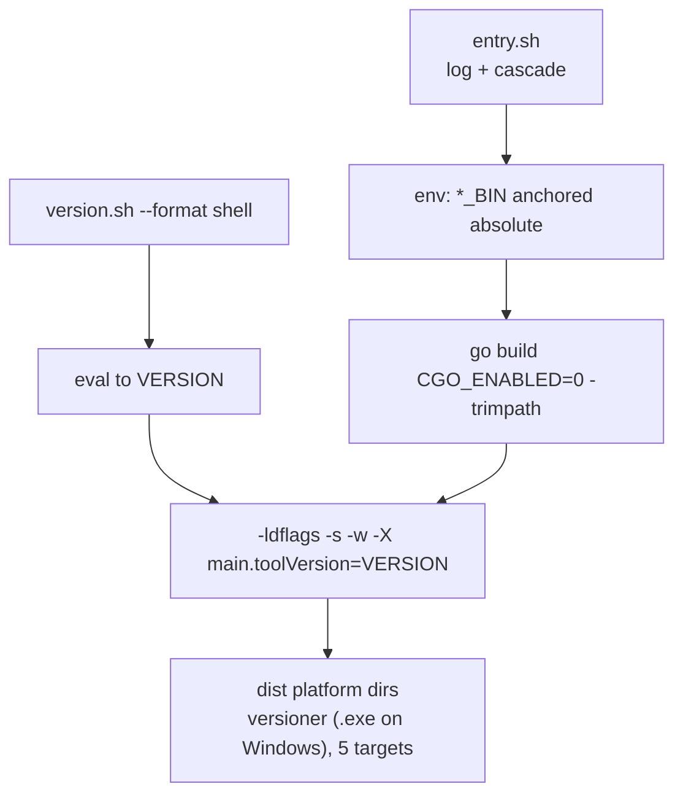

# The build script (`scripts/build.sh`)



Cross-compiles `versioner` for the release target matrix and stamps the
locally computed version into the binaries.

## What it does

1. Sources [entry.sh.md](entry.sh.md) (`"$ENTRY_DIR/entry.sh"`) for the
   [env cascade](env.sh.md) and `log()`, then `cd`s to the repository root.
2. Computes `VERSION`: from the environment if `VERSION` is set, otherwise
   by `eval`ing `scripts/version.sh --format shell`.
3. Requires `go` on `PATH` (fails with `log ERROR` and exit `1` otherwise).
4. Builds with `CGO_ENABLED=0`, `-trimpath`, and
   `-ldflags "-s -w -X main.toolVersion=$VERSION"` into
   `dist/<platform>/versioner` (`versioner.exe` for Windows), for the same
   matrix as the Makefile's `cross` target: `darwin-amd64`, `darwin-arm64`,
   `linux-amd64`, `linux-arm64`, `windows-amd64`.

The `versioner` binary's `--version` then reports the tag computed for
this repository at build time.

## Usage

```bash
scripts/build.sh          # build all five targets into dist/
VERSION=v0.0.0.0.0 scripts/build.sh   # override the stamped version
```

## Relationship to the Makefile

The Makefile's `cross` target uses the same platform matrix but stamps
`main.toolVersion=$(VERSION)` (default `dev`) without `-s -w`, and does not
compute the version itself. `build.sh` always derives (or honors an
overridden) `VERSION` via [version.sh.md](version.sh.md) and logs progress via
`log()`. `make cross` is what [release.sh](release.sh.md) drives.

## Related pages

- [entry.sh.md](entry.sh.md) · [env.sh.md](env.sh.md) — how `log()` and the cascade are loaded
- [version.sh.md](version.sh.md) — where `VERSION` comes from
- [release.sh.md](release.sh.md) — the release pipeline built on these binaries
