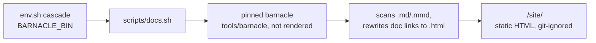

# The docs generator (`scripts/docs.sh`)



Generates the documentation site you are reading: it runs the pinned
barnacle binary (`tools/barnacle/update.sh` refreshes it; the bundle is
documented in `tools/barnacle/update.sh.md`) against this repository.

Barnacle scans the working tree for Markdown (`.md`) and Mermaid (`.mmd`)
files, renders each as a page, and keeps relative links between them.
Generated output is static HTML; it is written to `./site/` by default and
is never committed (`/site/` is in `.gitignore`).

## Usage

```bash
scripts/docs.sh                       # generate into ./site/
scripts/docs.sh --site ./public       # forward --site to barnacle
scripts/docs.sh --config ./docs/barnacle.json
scripts/docs.sh --help                # usage for this script
```

Any arguments other than `--help`/`-h` are forwarded to barnacle verbatim;
see `barnacle --help` for `--config`/`--site` semantics.

## How it locates barnacle

The script resolves the repository root from its own path, requires
[`scripts/entry.sh`](entry.sh.md) to exist (fails with a printed error and
exit `1` otherwise), and sources it. `BARNACLE_BIN` comes from the
[cascade](env.sh.md) (`tools/barnacle/v<version>/<platform>/barnacle[.exe]`);
if unset or not executable, the script fails with instructions to run
`tools/barnacle/update.sh` (or set `BARNACLE_BIN` explicitly). It then
runs barnacle with the repository root as cwd, so barnacle's
auto-discovered `./.barnacle.json` and default `./site/` output land at
the repository root regardless of the caller's cwd.

This repository's `.barnacle.json` sets the site title to `Versioner` and
excludes `tools` and `dist` from the scan (the bundled binaries stay out
of the site).

## What the site contains

Every `.md`/`.mmd` in the tree that is not excluded — see the
[root README](../README.md) and [AGENTS.md](../AGENTS.md). `.git`,
`node_modules`, `vendor`, `dist`, and the output directory are always
excluded by barnacle; hidden files and directories (the cascade's
`.common.env` et al.) are skipped unless `.barnacle.json` sets
`includeHidden` — none of the hidden cascade is rendered, so
[env.sh.md](env.sh.md) documents it.

## Related pages

- [entry.sh.md](entry.sh.md) · [env.sh.md](env.sh.md)
- The barnacle bundle and its refresher are documented in
  `tools/barnacle/update.sh.md` (source page; `tools/` is excluded from the
  barnacle scan, so it is not rendered).
