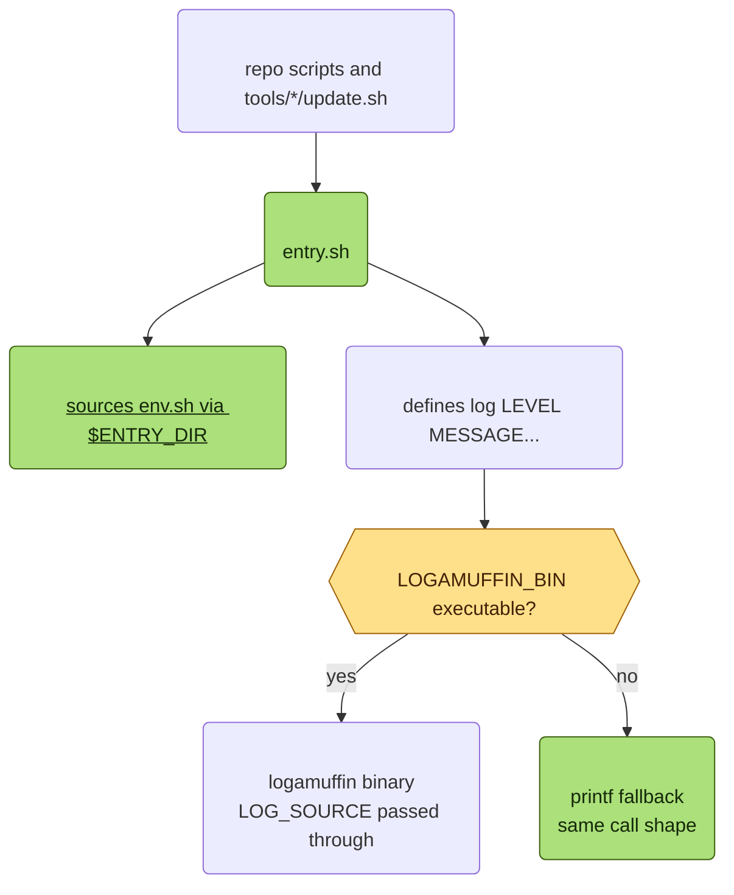

# The script entry point (`scripts/entry.sh`)



Every repository script (except [release.sh.md](release.sh.md), which is
self-contained) sources `scripts/entry.sh` instead of the individual
cascade files, because it does two jobs at once:

1. **It loads the environment** — it sources [env.sh.md](env.sh.md) via
   `$ENTRY_DIR/env.sh`.
2. **It defines `log()`** — the shared logging function used by every
   script here and by the `tools/<name>/update.sh` refreshers.

## `log()` semantics

`log LEVEL MESSAGE...` forwards to the pinned logamuffin binary (bundle:
`tools/logamuffin/`, documented in `tools/logamuffin/update.sh.md`) referenced
by `LOGAMUFFIN_BIN`. The caller context is passed through in `LOG_SOURCE`
(`file[:function]:line` — `BASH_SOURCE[1]`, `BASH_LINENO[0]`,
`FUNCNAME[1]`), and logamuffin's own exit code (`0`, or `2` for
usage/config errors) is preserved even under `set -e`.

When the binary is missing (a fresh clone before tools are populated),
`log()` falls back to a `printf` implementation with the same call shape:
word-to-severity mapping (`TRACE`=5, `DEBUG`=10, `INFO`=20,
`WARNING`/`WARN`=30, `ERROR`=40, `CRITICAL`/`FATAL`=50, `ALWAYS`=-1,
numeric levels pass through), `LOG_LEVEL`/`LOGAMUFFIN_LEVEL` threshold
filtering (default `INFO`), and stream routing (levels ≥ 40 to stderr).
The fallback with zero arguments prints a usage line and returns `2`;
otherwise it returns `0`.

## Usage

```bash
#!/usr/bin/env bash
set -euo pipefail
SCRIPT_DIR=$(cd -- "$(dirname -- "${BASH_SOURCE[0]}")" && pwd)
. "$SCRIPT_DIR/entry.sh"   # or env.sh when you only need the cascade, not log()
```

## Related pages

- [env.sh.md](env.sh.md) — the cascade `entry.sh` loads
- [version.sh.md](version.sh.md) — the version script that sources `entry.sh`
- [build.sh.md](build.sh.md) · [docs.sh.md](docs.sh.md) — other consumers
