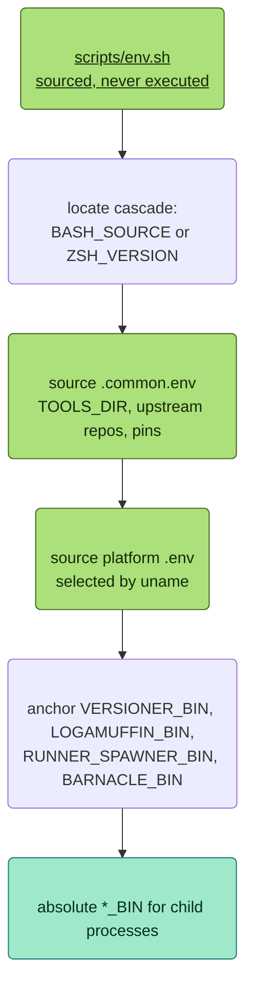

# The environment cascade (`scripts/env.sh` + the hidden `.*.env` files)

`scripts/env.sh` is the plumbing that makes the pinned helper tools
resolvable from any script, in any working directory, on every supported
platform. It is sourced — never executed — and it works from both bash and
zsh.

## What it does

1. Locates the cascade relative to itself (bash via `$BASH_SOURCE`, zsh via
   `$ZSH_VERSION` with `%x`, falling back to `$0`), and sets
   `ENV_DIR` (this directory) and `REPO_ROOT_DIR` (its parent).
2. With `set -a` (everything sourced is exported), sources `.common.env`,
   then the platform file selected by `uname -s`/`uname -m` — one of
   `.macos-x86_64.env`, `.macos-arm64.env`, `.linux-x86_64.env`,
   `.linux-arm64.env`, `.windows-x86_64.env`, `.windows-arm64.env`
   (`MINGW*`/`MSYS*`/`CYGWIN*` all map to the Windows files). An
   unsupported platform prints `Unsupported platform: …` to stderr and
   returns `1` (or exits `1`).
3. **Anchors** every repository-relative `*_BIN` (`VERSIONER_BIN`,
   `LOGAMUFFIN_BIN`, `RUNNER_SPAWNER_BIN`, `BARNACLE_BIN`) to
   `REPO_ROOT_DIR`; absolute paths and empty values are left untouched.
   After sourcing, the non-empty tool paths are absolute.
4. Ends with `set +a`.

## The hidden files

Hidden files are excluded from barnacle's default scan, so their contract
is documented here:

- **`.common.env`** — `TOOLS_DIR=tools`; the upstream `fordaj/*` repository
  slugs; and the pinned `*_VERSION_DIR`s. The current pins:

  | Tool           | Repo slug               | Pinned version dir                |
  | -------------- | ----------------------- | --------------------------------- |
  | versioner      | `fordaj/Versioner`      | `tools/versioner/v0.0.3.0.5`      |
  | logamuffin     | `fordaj/logamuffin`     | `tools/logamuffin/v254.1.3.0.48`  |
  | runner-spawner | `fordaj/runner-spawner` | `tools/runner-spawner/v0.0.1.2.6` |
  | barnacle       | `fordaj/barnacle`       | `tools/barnacle/v0.0.2.1.25`      |

  It also carries `VERSIONER_TAG_PATTERN=v[0-9]*` and
  `VERSIONER_CONFIG_FILE=.versioner.json`. Note that
  `VERSIONER_TAG_PATTERN` is a variable the `versioner` binary itself
  honours (see [../config.go.md](../config.go.md)) — its pinned value matches the
  binary's built-in default. `VERSIONER_REPO`/`VERSIONER_CONFIG_FILE` are
  pin metadata; the binary does not read them (it reads `VERSIONER_CONFIG`).

  **The versioner pin is dangling by design.** This repository _is_
  versioner: `tools/versioner/` does not exist, and every platform file
  sets `VERSIONER_BIN=""` (with a comment saying so).
  [version.sh.md](version.sh.md) therefore falls back to `go run .` when
  `VERSIONER_BIN` is unset or not executable.

- **`.<platform>.env`** — one per supported platform, same six names as
  above. Each sets `PROJECT_PLATFORM` (e.g. `macos-arm64`) and the `*_BIN`
  paths pointing into the pinned version dirs, for example
  `LOGAMUFFIN_BIN="${LOGAMUFFIN_VERSION_DIR}/${PROJECT_PLATFORM}/logamuffin"`
  (`.exe` suffix on the Windows files). `VERSIONER_BIN=""` everywhere, as
  noted. The Linux files additionally note that runner-spawner reports
  unsupported on Linux (macOS + Windows only) but the binary is still
  shipped for a uniform bundle layout.

Because `set -a` is active while sourcing, these variables land in the
environment of any child process — including `versioner` invocations.

## Related pages

- [entry.sh.md](entry.sh.md) — the entry point most scripts source (loads this
  file and defines `log()`)
- [docs.sh.md](docs.sh.md) — the docs generator that resolves `BARNACLE_BIN`
  through this cascade
- `tools/README.md` — the bundles selected by the `*_BIN` variables
  (source page; `tools/` is excluded from the barnacle scan, so it is not
  rendered)
- [../config.go.md](../config.go.md) — the `VERSIONER_*` variables the binary
  itself honours
