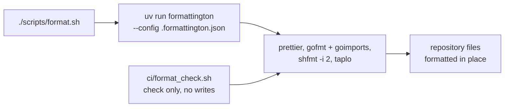

# The format driver (`scripts/format.sh`)



`scripts/format.sh` formats this repository in place using
[formattington](https://github.com/fordaj/formattington). It is the local
counterpart to the CI formatting gate (`ci/format_check.sh`, which exits
non-zero when anything needs formatting).

## What it does

The script is a thin wrapper: it checks for `uv` (exits `1` with a link if
missing), prepends `$(go env GOPATH)/bin` to `PATH` when Go is available
(so `go install`-ed `goimports` resolves), and then runs

```text
uv run formattington "$@" --config <repo>/.formattington.json all
```

`.formattington.json` pins the formatter commands per file type:
`prettier` (md/json/yaml), `gofmt` + `goimports` (go), `shfmt -i 2`
(shell), `taplo` (toml). Extra arguments are forwarded before `all`
(e.g. `--series` for sequential, ordered output, `--verbose` to show which
formatter executables were resolved). `--config` is managed by the script
itself; do not pass it.

Formattington is pinned in `pyproject.toml` (a git commit) and locked in
`uv.lock`; Python 3.14 is used (`.python-version`). `uv run` creates
`.venv/` automatically — no manual venv setup.

## Prerequisites

The formatter executables must be on `PATH` — `uv`, `shfmt`, `prettier`,
`taplo`, and `goimports` (the script header notes formattington exits
`127` when one is missing). Install e.g. via your OS package manager,
`npm install -g prettier`, or `go install
golang.org/x/tools/cmd/goimports@latest`.

The bundled binaries under `tools/` are skipped, as are `dist/` and other
generated locations.

## Where it is used

- Locally: `./scripts/format.sh` (see `AGENTS.md` and the README "Formatting
  and CI" section).
- CI: `.github/workflows/ci.yml` runs `ci/format_check.sh` (not this
  script) as the Check Formatting job.

## Related pages

- [README.md](../README.md) — user-facing formatting/CI notes
- [scripts/docs.sh.md](docs.sh.md) — the other self-hosted tooling driver
