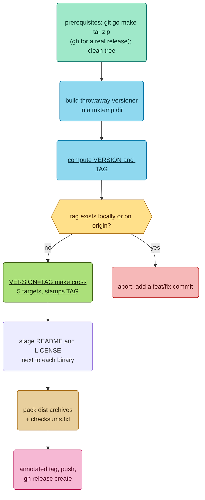

# The release pipeline (`scripts/release.sh`)



Cuts a release by **dogfooding** `versioner`: it builds `versioner` from
source, uses it to compute the next `VERSION`/`TAG`, cross-compiles the
binaries with that tag stamped in (`-X main.toolVersion=$TAG`), tags
`HEAD`, pushes the tag, and publishes a GitHub release. Unlike the other
scripts here, it is self-contained (its own `log`/`die`); it does **not**
source [entry.sh](entry.sh.md).

## Usage

```bash
scripts/release.sh              # compute version, cross-compile, tag, push, gh release create
scripts/release.sh --dry-run    # compute + build only; touch nothing remote (warns on a dirty tree)
scripts/release.sh --help       # usage
```

Unknown arguments print usage to stderr and exit `2`.

## What it does

1. Checks prerequisites: `git`, `go`, `make`, `tar`, `zip` on `PATH` — plus
   `gh` (authenticated) for a real release. Must be inside a git
   repository; the working tree must be clean (in `--dry-run` a dirty tree
   is only a warning). Best-effort `git fetch origin --tags` (fatal for a
   real release, a warning for dry runs).
2. Builds a throwaway `versioner` in a `mktemp -d` (or uses `$VERSIONER_BIN`
   if set), and runs it against the repository root to compute
   `VERSION`/`TAG`. The tag must match `vX.Y.Z.W.V` (five numeric
   components) and must not already exist locally or on `origin` — make a
   new `feat:`/`fix:` commit to bump the version and re-run.
3. Runs `VERSION=$TAG make cross` → `dist/<arch>/versioner[.exe]` for the
   five Makefile targets (`darwin-amd64`, `darwin-arm64`, `linux-amd64`,
   `linux-arm64`, `windows-amd64`). Stages `README.md` and `LICENSE` next
   to each binary, and best-effort checks the native binary's
   `--version` contains `$TAG` (guards the ldflags wiring; skipped when
   the native binary is missing).
4. Packs each architecture into `dist/Versioner_<TAG>_<arch>.tar.gz`
   (`.zip` on Windows; flat archives: binary + README + LICENSE), then
   writes `dist/checksums.txt` (SHA-256 via `shasum` or `sha256sum`).
5. Creates an annotated tag, pushes it, and creates the GitHub release
   (`gh release create --generate-notes`) with the five archives plus
   `checksums.txt`. If a release for the tag already exists, it dies and
   suggests `gh release upload` manually.

`--dry-run` stops after step 4 and prints what it _would_ do (tag, push,
release) without touching anything remote.

## Notes

- `VERSIONER_BIN` is the only environment override (a prebuilt
  versioner for the version computation — not to be confused with the
  bundle pins in the [cascade](env.sh.md), which are unused here).
- `dist/` is git-ignored; archives and checksums are never committed.
- Prerequisites for a real release: `HEAD` should already be pushed and
  `gh auth login` done.

## Related pages

- [build.sh.md](build.sh.md) — the cross-compile this depends on (via `make cross`)
- [version.sh.md](version.sh.md) — the version computation it dogfoods
- [entry.sh.md](entry.sh.md) · [env.sh.md](env.sh.md) — the cascade this script does _not_ use
