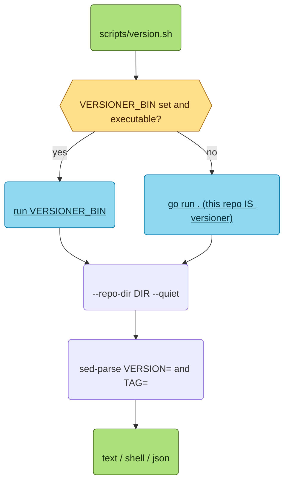

# The version script (`scripts/version.sh`)



Prints the version of this repository as computed by `versioner` — the same
computation the release pipeline dogfoods, so a local build and the
published tag can never drift apart.

## Usage

```bash
scripts/version.sh                 # VERSION=<v> and TAG=<t> lines (default)
scripts/version.sh --format text   # same
scripts/version.sh --format shell  # export VERSION=... and export TAG=...
scripts/version.sh --format json   # the raw versioner JSON document
```

`--format` requires a value (`--format=text` also works); `--help`/`-h`
prints usage. Unknown arguments are a usage error (exit `2`).

## How it works

Sources [entry.sh.md](entry.sh.md) for the [cascade](env.sh.md) and `log()`.
`VERSIONER_REPO_DIR` (or the repository root from `REPO_ROOT_DIR`) selects
the repository, defaulting to the parent of `scripts/`.

Because this repository **is** versioner, `VERSIONER_BIN` is normally empty
(the platform files in the cascade set it to `""`), and the script falls
back to `go run .` when no versioner binary is found (it errors and exits
`1` only if `go` is also missing). When `VERSIONER_BIN` is set and
executable, that binary is used instead.

Either way it runs `versioner --repo-dir <dir> --quiet` (plus
`--format json` for the JSON case), then parses the `VERSION=`/`TAG=`
lines with `sed`. Unparseable output is an error (exit `1`). For `text`
and `shell` formats it re-prints only `VERSION=`/`TAG=` (or
`export VERSION=`/`export TAG=`); `json` passes the raw document through.

## Consumers

- [build.sh.md](build.sh.md) — `eval`s `--format shell` output to stamp
  `main.toolVersion` into the cross-compiled binaries.
- [release.sh.md](release.sh.md) — builds versioner from source itself (it does
  not call this script) to compute the release tag.

## Related pages

- [entry.sh.md](entry.sh.md) · [env.sh.md](env.sh.md)
- [../config.go.md](../config.go.md) — the `VERSIONER_*` variables the binary honours
