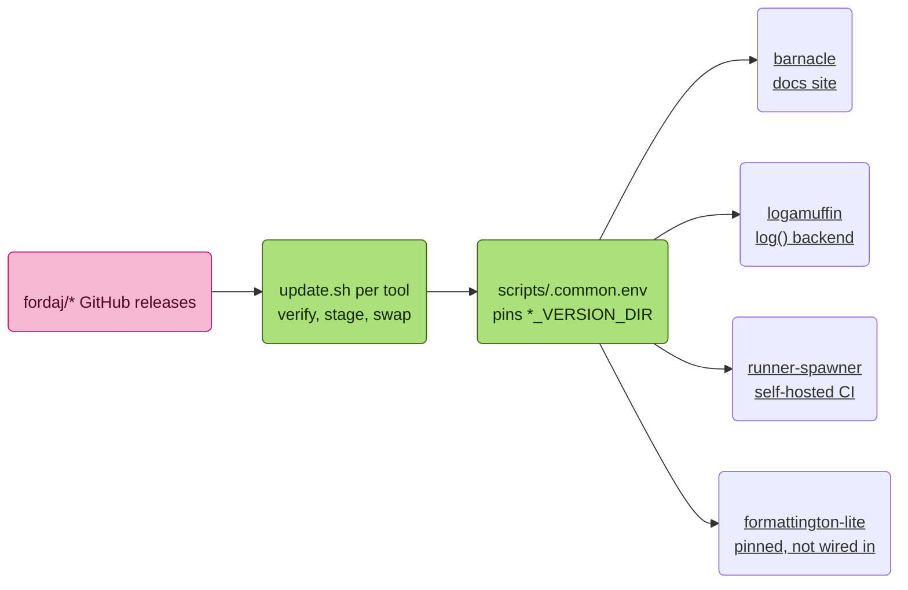

# Pinned helper tools (`tools/`)



`tools/` carries the repository's pinned helper binaries — logging, docs,
and runner-provisioning tooling — plus one `update.sh` per tool that
refreshes them (thin wrappers over the shared
[`tools/update.sh`](update.md) implementation). These are **not** the formatters this repository formats
itself with (those are driven by [`format.sh`](../scripts/format.sh.md) via `uv` and
`pyproject.toml`), and `versioner` itself is **not** bundled here — this
repository *is* versioner (see the note below).

## Bundling convention

Every bundle follows the same layout:

```text
tools/<name>/
  update.sh           # refresh from the upstream GitHub release
  v<version>/<platform>/<binary>[.exe]
```

- Binaries are pinned by version directory; the pinned version is named by
  `*_VERSION_DIR` in [`scripts/.common.env`](../scripts/env.sh.md).
- `<platform>` is the hyphenated `<os>-<arch>` name (`linux-x86_64`,
  `macos-arm64`, `windows-x86_64`, …). All four bundles ship the same six
  platforms: macOS/Linux/Windows × x86_64/arm64.
- `update.sh` downloads the latest (or `--tag`ged) upstream release via
  `gh`, verifies checksums, stages into a temporary directory, swaps in
  atomically, and deletes superseded version folders only after the new one
  is staged — a failed refresh leaves the previous bundle intact. Each
  bundle's `update.sh` is a thin wrapper exporting per-tool settings
  (repo slug, binary name, asset filter, which extras to keep, whether a
  missing checksums file is fatal) and execs the shared
  [`tools/update.sh`](update.md); each wrapper has `--dry-run`, `--help`,
  and resolves its own directory, so it can run from anywhere. The
  committed bundle is binaries only; if an upstream archive carries
  `LICENSE` (barnacle) or `NOTICE.md`/`LICENSES/` (formattington-lite),
  `update.sh` copies it into each platform dir, but none are present in
  the committed pins.

## The bundles

| Tool | Used for | Docs |
| --- | --- | --- |
| [barnacle](barnacle/update.sh.md) | Renders this documentation site (`scripts/docs.sh`) | [update.sh](barnacle/update.sh.md) |
| [formattington-lite](formattington-lite/update.sh.md) | The `formattington` binary bundle — pinned for uniformity; **not wired into** this repo's scripts (formatting runs via `format.sh` + `uv`) | [update.sh](formattington-lite/update.sh.md) |
| [logamuffin](logamuffin/update.sh.md) | Structured logging backend for `log()` in the scripts | [update.sh](logamuffin/update.sh.md) |
| [runner-spawner](runner-spawner/update.sh.md) | Manages self-hosted CI runners (driven by `.runner-spawner.json`) | [update.sh](runner-spawner/update.sh.md) |

**No `tools/versioner` bundle:** this repository *is*
[versioner](https://github.com/fordaj/Versioner). `scripts/.common.env`
still pins `VERSIONER_VERSION_DIR` (`tools/versioner/v0.0.3.0.5`) and the
platform files set `VERSIONER_BIN=""`; [scripts/version.sh](../scripts/version.sh.md)
falls back to `go run .`. See [scripts/env.sh.md](../scripts/env.sh.md).

`scripts/.common.env` and `scripts/.<platform>.env` select these via
`*_VERSION_DIR`/`*_BIN`; see [env.sh.md](../scripts/env.sh.md). Archives are
platform-native (`.tar.gz` on macOS/Linux, `.zip` on Windows); there is no
7zip dependency anywhere in this repository.

## Refreshing a pinned tool

```bash
tools/barnacle/update.sh            # download the latest release, verify, swap
tools/barnacle/update.sh --dry-run  # show what would change
```

(Same flags for the other three.) Refreshes are checksum-verified when the
release ships a `checksums.txt`/`SHA256SUMS.txt`; a missing file is a
warning for barnacle, formattington-lite, and logamuffin — but
[runner-spawner](runner-spawner/update.sh.md) refuses to install unverified
binaries. Legacy `.7z` assets are still readable (a p7zip install is only
needed until new releases ship platform-native archives).

## Related pages

- [update.md](update.md) — the shared implementation behind `tools/update.sh`
- [scripts/env.sh.md](../scripts/env.sh.md) — how the cascade selects these binaries
- [scripts/docs.sh.md](../scripts/docs.sh.md) — barnacle in action
- [README.md — repository layout](../README.md)
