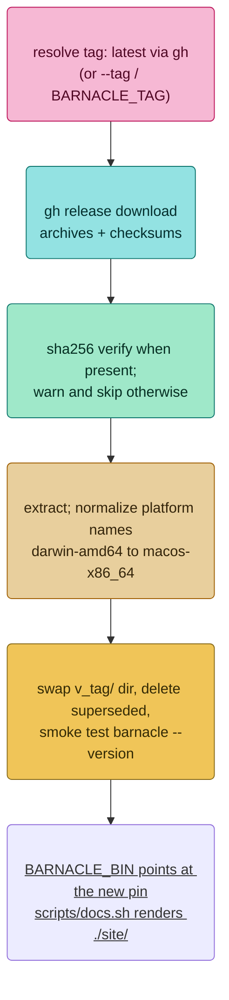

# The barnacle bundle (`tools/barnacle/`)



[Barnacle](https://github.com/fordaj/barnacle) is a documentation-site
generator: it renders the `.md` and `.mmd` files scattered through a
repository into a static, navigable HTML site. Versioner uses it to render
*this* documentation; the site you may be reading was built by it.

## Layout

```text
tools/barnacle/
  update.sh                     # refresh from fordaj/barnacle releases
  v0.0.2.1.25/
    macos-arm64/barnacle
    macos-x86_64/barnacle
    linux-arm64/barnacle
    linux-x86_64/barnacle
    windows-arm64/barnacle.exe
    windows-x86_64/barnacle.exe
```

## `update.sh` in detail

`update.sh` is a thin wrapper around [`tools/update.sh`](../update.md) —
the shared download/verify/stage/swap implementation. It declares the
bundle's settings and execs that script; see
[../update.md](../update.md) for the full algorithm.

Barnacle's settings: repository `fordaj/barnacle`, binary `barnacle`,
tag override `BARNACLE_TAG`, slug override `BARNACLE_REPO`, every
platform archive installed (no suffix filter), `LICENSE` copied next to
each binary when the archive carries one (none is present in the
committed `v0.0.2.1.25`), missing checksums file is a warning (not fatal).

`--dry-run` lists assets without touching anything; `--help` prints
usage. The script sources [`scripts/entry.sh`](../../scripts/entry.sh.md) for
logging and can run from any directory.

## How the repository uses it

[scripts/docs.sh](../../scripts/docs.sh.md) resolves `BARNACLE_BIN` through
the [env cascade](../../scripts/env.sh.md) and generates `./site/` from the
repo root; the output is git-ignored.

## Related pages

- [../README.md](../README.md) — the bundle index
- [../update.md](../update.md) — the shared implementation behind this wrapper
- [../../scripts/README.md](../../scripts/README.md) — the scripts that consume the bundle
