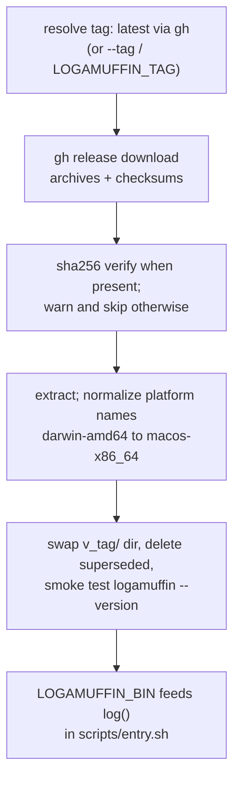

# The logamuffin bundle (`tools/logamuffin/`)



[Logamuffin](https://github.com/fordaj/logamuffin) is the structured
logging backend for the `log()` function defined in
[`scripts/entry.sh`](../../scripts/entry.sh.md). Every script in `scripts/`
and every `tools/<name>/update.sh` logs through it (with a printf
fallback when the binary is absent).

## Layout

```text
tools/logamuffin/
  update.sh                     # refresh from fordaj/logamuffin releases
  v254.1.3.0.48/
    macos-arm64/logamuffin
    macos-x86_64/logamuffin
    linux-arm64/logamuffin
    linux-x86_64/logamuffin
    windows-arm64/logamuffin.exe
    windows-x86_64/logamuffin.exe
```

## `update.sh` in detail

`update.sh` is a thin wrapper around [`tools/update.sh`](../update.md) —
the shared download/verify/stage/swap implementation. It declares the
bundle's settings and execs that script; see
[../update.md](../update.md) for the full algorithm.

logamuffin's settings: repository `fordaj/logamuffin`, binary
`logamuffin`, tag override `LOGAMUFFIN_TAG`, slug override
`LOGAMUFFIN_REPO`, every platform archive installed (no suffix filter),
only the binary is kept, missing checksums file is a warning (not
fatal).

`--dry-run` lists assets without touching anything; `--help` prints
usage. The script sources [`scripts/entry.sh`](../../scripts/entry.sh.md) for
logging and can run from any directory.

## How the repository uses it

[`scripts/entry.sh`](../../scripts/entry.sh.md) forwards `log()` calls to the
binary at `LOGAMUFFIN_BIN` (selected by the
[cascade](../../scripts/env.sh.md)), passing the call site's `file:line` in
`LOG_SOURCE`.

## Related pages

- [../README.md](../README.md) — the bundle index
- [../update.md](../update.md) — the shared implementation behind this wrapper
- [../../scripts/entry.sh.md](../../scripts/entry.sh.md) — the `log()` consumer
