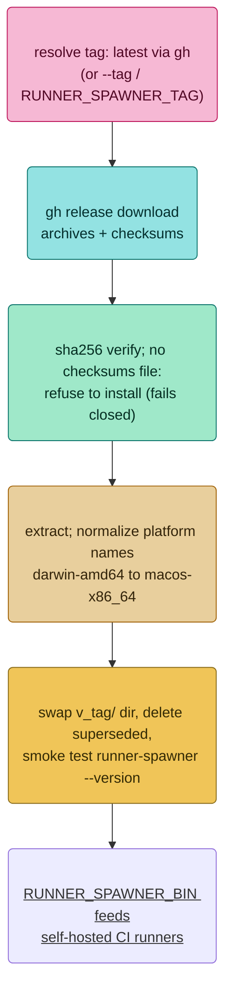

# The runner-spawner bundle (`tools/runner-spawner/`)



[Runner-spawner](https://github.com/fordaj/runner-spawner) provisions
self-hosted GitHub Actions runners. This repository's CI (`.github/
workflows/ci.yml`) runs on self-hosted macOS and Windows runners managed
with it — see `.runner-spawner.json` (`runnerNames`, `runnersDir`,
`runnerGroup`, `runnerVersion`) and `AGENTS.md`.

Runner-spawner supports macOS and Windows only; on Linux the bundled
binary is shipped for a uniform layout but reports itself unsupported (the
platform env files note this).

## Layout

```text
tools/runner-spawner/
  update.sh                     # refresh from fordaj/runner-spawner releases
  v0.0.1.2.6/
    macos-arm64/runner-spawner
    macos-x86_64/runner-spawner
    linux-arm64/runner-spawner
    linux-x86_64/runner-spawner
    windows-arm64/runner-spawner.exe
    windows-x86_64/runner-spawner.exe
```

## `update.sh` in detail

`update.sh` is a thin wrapper around [`tools/update.sh`](../update.md) —
the shared download/verify/stage/swap implementation. It declares the
bundle's settings and execs that script; see
[../update.md](../update.md) for the full algorithm.

runner-spawner's settings: repository `fordaj/runner-spawner`, binary
`runner-spawner`, tag override `RUNNER_SPAWNER_TAG`, slug override
`RUNNER_SPAWNER_TOOL_REPO` (note the `_TOOL_` infix, so it does not
collide with other `RUNNER_SPAWNER_*` variables), every platform archive
installed (no suffix filter), only the binary is kept. **If no checksums
file is present the script refuses to install** (`no checksums.txt/
SHA256SUMS.txt in <tag> release; refusing to install unverified
binaries`) — the only bundle that fails closed.

`--dry-run` lists assets without touching anything; `--help` prints
usage. The script sources [`scripts/entry.sh`](../../scripts/entry.sh.md) for
logging and can run from any directory.

## Related pages

- [../README.md](../README.md) — the bundle index
- [../update.md](../update.md) — the shared implementation behind this wrapper
- [../../scripts/env.sh.md](../../scripts/env.sh.md) — the cascade that selects `RUNNER_SPAWNER_BIN`
