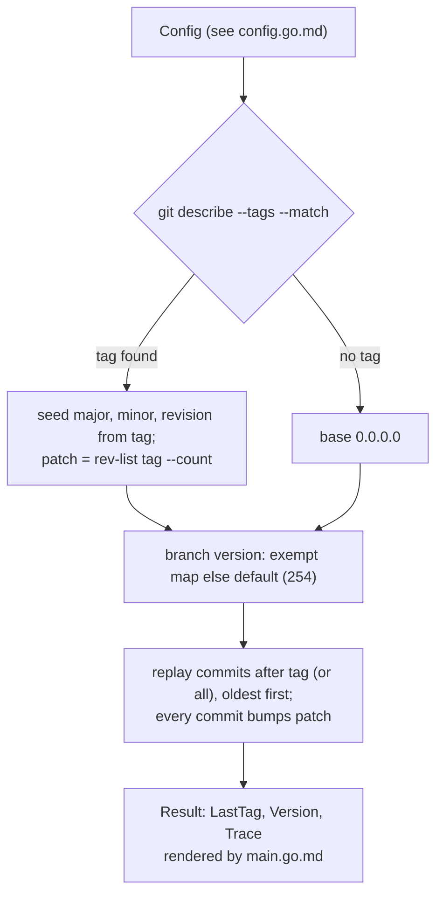

# Version computation (`version.go`)



`version.go` holds the pure version rules and the git plumbing behind
them. Given a `Config` (see [config.go.md](config.go.md)), `Compute` derives
`VERSION`/`TAG` from git history. The package doc mirrors the legacy
`get_version.sh` semantics:

```text
VERSION = <branch-version>.<major>.<minor>.<revision>.<patch>
TAG     = "v" + VERSION
```

## Data types

`Version` (`Branch`, `Major`, `Minor`, `Revision`, `Patch`;
`String()` renders `254.1.2.3.4`, `Tag()` prefixes `v`), `CommitType`
(`feat`, `feature`, `fix`, `CommitOther`), `TraceEntry` (`{Commit,
Version}`), `Result` (`LastTag`, `Branch`, `Version`, `Subjects`, `Trace`).

## Pure functions

- `ParseTag(tag)` — requires a leading `v`; missing components default to
  `0` (like `IFS='.' read`); extra components beyond the fifth are
  ignored; non-numeric components are an error. Callers ignore the parsed
  branch and overwrite `patch`.
- `ClassifyCommit(subject)` — text before the first `:`, lowercased; any
  `!` means breaking (then a trailing `!` is stripped); the remainder is
  matched against `^(feat|feature|fix)(\(.*\))?$`. Case-insensitive.
- `ApplyBump(v, subject)` — breaking feat/feature/fix ⇒ `major++`,
  `minor`/`revision` reset; feat/feature ⇒ `minor++`, `revision` reset;
  fix ⇒ `revision++`; **every** replayed commit ⇒ `patch++`.
  Unrecognised prefixes (incl. unrecognised breaking types like
  `chore!:`) only bump `patch`.

## Git plumbing

`gitRun` is a package-level variable (`exec.Command("git", …)`) so tests
can stub git without a real repository. `gitTrimmed` wraps it for the
lenient call sites (log-and-swallow); everything else surfaces errors.
Built on them:

- `LastTag(dir, pattern)` — `git describe --tags --abbrev=0 --match`;
  errors swallowed (the shell's `|| true`): missing tag and missing repo
  both yield `""`.
- `RevListCount(dir, ref)` — `git rev-list <ref> --count`.
- `CurrentBranch(dir)` — `git branch --show-current`; errors swallowed.
- `LogSubjects(dir, ref)` — `git log <ref> --format=%s --reverse`;
  `\r` trimmed per line.

## `Compute(cfg)`

1. Last tag matching `cfg.TagPattern`. If present: seed `major`/`minor`/
   `revision` from it (parse errors are fatal), then overwrite `patch`
   with `git rev-list <tag> --count`. No tag ⇒ base `0.0.0.0`.
2. Branch: `cfg.Branch` (if set) else `CurrentBranch`; branch version is
   `cfg.ExemptBranches[branch]` when exempt, else `cfg.DefaultBranchVersion`
   (`254` by default; detached `HEAD` uses the default).
3. Replay commits after the tag (`<tag>..<head>`) oldest-first — or all
   of `head` when untagged — with `ApplyBump`, one `TraceEntry` per
   commit.

## Where it is used

[main.go.md](main.go.md) — `run` calls `Compute` and renders the `Result`.
Unit tests live in `version_test.go` (stubbed via `gitRun`, `stubGit`
helper) and `config_test.go`.

## Related pages

- [config.go.md](config.go.md) — configuration inputs
- [main.go.md](main.go.md) — CLI wiring and output formats
- [README.md](README.md) — the version scheme as documented for users
